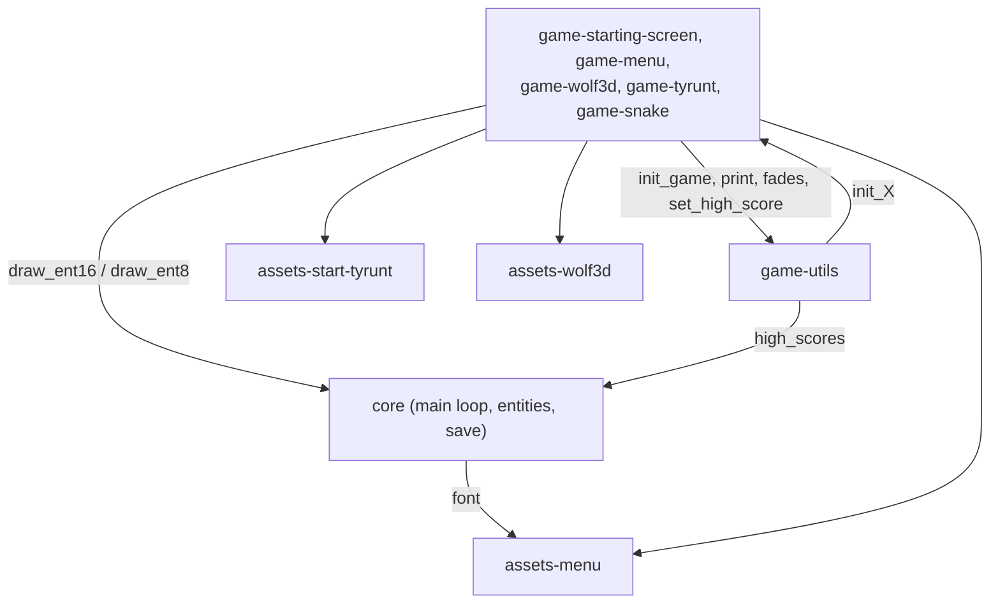

# Architecture

Module paths are listed in the [README layout](../README.md#layout).

## Modules

- Every module includes `headers` (`include/`), which declares `game_t`, the entity, map and window
  types, and each game's `init_X`/`update_X`.
- `core` boots the cartridge and calls the current `update` callback; `game-utils` starts a game by
  calling its `init_X`, and every game calls back into `game-utils` to switch games, print text,
  fade the palettes and save its high score (into `core`'s `high_scores`).
- Each game draws its sprites with `core`'s `draw_ent16`/`draw_ent8` and loads its own asset module;
  `core` loads the font from `assets-menu` at boot.

## Data flow

One session, from power-on to a saved high score:

1. `core`: `main` calls `init` (zero the game state, enable 8x16 sprites and CGB fast CPU, load the
   font at BG tile 209, reset high scores above 999 to 0), then loops: `actual_frame++`,
   `game->update(game)`, `vsync()`.
2. `game-starting-screen`: the logo scrolls up; START calls `init_game(this, MENU)`.
3. `game-utils`: `init_game` fades out, clears the screen and sprites, runs the target's `init_X`
   (which installs its `update_X` as `game->update`), and fades in.
4. `game-menu`: the player walks to a door; A or START calls `init_game` with WOLF_3D, TYRUNT or
   SNAKE.
5. The game runs one `update_X` per frame. On game over it calls `set_high_score(id, score)`
   (`game-utils`), which writes `high_scores` in save RAM bank 0 only if the score is higher; SELECT
   or the game-over screen returns to MENU through `init_game`.

## Decisions

- Per-game state lives in one fixed 128-byte union (`g_game_data`, `g_ent_data`,
  `MAX_PLUG_IN_BYTES`), because there is no heap and only one game runs at a time; rejected:
  per-game globals (waste WRAM) and malloc.
- Games switch by replacing the `game->update` callback via `init_game`, so adding a game only needs
  an `init_X`/`update_X` pair; rejected: a switch in `main` edited for each game.
- High scores are in battery-backed SRAM at 0xA000 (MBC5 + RAM + battery, `-Wl-yt0x1B`) with
  `save.o` built with `-Wf-ba0` to pin them to RAM bank 0, so they survive power-off and all code
  uses `SWITCH_RAM(0)`; rejected: no persistence or password scores.
- The Wolf3D raycaster casts 20 rays drawn as background tile columns and redraws only changed
  columns, to fit the tile-based VRAM and its access window at a playable frame rate; rejected:
  per-pixel rendering.
